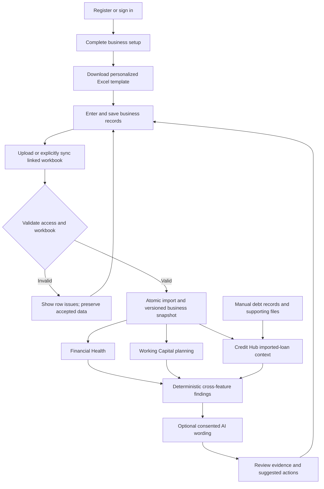

# Shay Sett (ရှေ့ဆက်): Complete Project Proposal, Workflows, and ChatGPT Context

Prepared on 23 October 2026, Asia/Rangoon.

This is a self-contained context document for writing a project proposal, report, presentation, pitch, demonstration script, website copy, or business strategy. It combines the team's stated intentions with the current local project implementation. It contains no credentials or private customer records.

## 1. Instructions for ChatGPT receiving this document

Treat this document as the project context, rather than assuming the product is a generic accounting app or a lending platform. Use **Shay Sett (ရှေ့ဆက်)** as the public product name. The source repository and some older documents use **BIZFLOW/BizFlow**; these refer to this same project, not another product.

Keep three categories separate:

- **Implemented:** the relevant user interface or backend workflow exists in the current project. This does not mean every external integration has been verified in production.
- **Conditional:** the capability needs complete source data, supported calculation inputs, or a configured external service.
- **Proposed:** a business plan, release requirement, future feature, target, or suggested improvement. Do not describe it as launched.

Do not invent market statistics, customers, testimonials, revenue, subscription prices, research participants, bank partnerships, regulatory approvals, funding, launch dates, or measured business results. If these are required, use clearly marked placeholders or ask for the missing facts. The team has not supplied a validated market-size study or a detailed operating budget.

Write professional, accessible content. Explain financial terms in ordinary language. For Burmese output, use natural Burmese and retain English feature names where helpful. Preserve the distinction between actual records, observed balances, user assumptions, estimated schedules, and AI-generated wording.

Do not claim that the product automatically approves loans, transfers funds, submits applications to banks, guarantees savings, verifies lender documents, provides audited financial statements, or predicts business success. Do not claim the AI independently calculates the underlying financial facts.

## 2. Project identity and executive proposal

**Public name:** ရှေ့ဆက် — Shay Sett.

**Project category:** A web application for SME financial visibility, working-capital planning, loan record management, credit preparation, and evidence-based business analysis.

**Primary audience:** Myanmar small and medium business owners who use Excel and need a clearer understanding of sales, expenses, cash movements, inventory, customer receivables, supplier balances, and existing debt.

**Current currency:** Myanmar kyat (MMK). The workbook contract does not provide general multicurrency accounting.

**Languages and interface:** English and Burmese, light and dark appearance, responsive layouts, and a collapsible navigation sidebar. The preferred visual direction is warm brown and orange, readable solid card surfaces, and plain page headings where requested. Decorative background waves should not show through cards.

**Suggested tagline:** “ရှေ့ဆက် — စာရင်းကို နားလည်၊ လုပ်ငန်းကို ရှေ့ဆက်။”

### Executive summary

Shay Sett proposes a practical way for SME owners to turn structured business records into understandable financial information and next steps. Many owners can record transactions but still struggle to understand why money is unavailable, which customers have not paid, whether inventory is tying up working capital, and what records they need before discussing financing.

The application starts with a personalized Excel workbook. After the owner uploads valid records, the platform creates a shared, business-specific data snapshot used by Financial Health, Working Capital, Credit Hub, and AI Analyzer. This connects record preparation, financial visibility, planning, and interpretation within one workspace.

Financial Health explains recorded financial performance and balances. Working Capital lets users inspect inventory and explore scenarios without changing actual records. Credit Hub helps organize existing loans, payment information, and financing documents. AI Analyzer turns verified findings into clearer explanations and suggested actions, with rules-based results available when external AI wording is unavailable.

The proposed commercial model offers the first month free, followed by a paid subscription for users who choose to continue. Recurring revenue is intended to support hosting, storage, maintenance, customer support, and AI operating costs. Exact pricing, billing, trial enforcement, and paid access controls remain commercial and implementation work rather than completed product features.

The present project is a functioning local implementation with conditional external integrations. It should be presented as a developed prototype/MVP progressing toward a verified pilot, rather than as an already deployed commercial platform with proven financial outcomes.

## 3. Problem definition

The project addresses connected operational problems:

1. **Fragmented records:** sales, purchases, receipts, expenses, and debt information may be spread across spreadsheets and paper records.
2. **Confusion between sales and cash:** a business can make credit sales while still lacking money to pay suppliers or operating costs.
3. **Outstanding payments are hard to follow:** owners need to distinguish money customers owe from money the business owes others.
4. **Inventory can hold cash:** buying more stock without reviewing existing stock and recent sales can increase pressure on working capital.
5. **Planning is difficult:** owners may not know how collections, stock turnover, payment timing, or reserves affect short-term cash needs.
6. **Debt information is incomplete:** an outstanding principal balance, an actual repayment, and a future scheduled instalment are different facts.
7. **Credit preparation is disorganized:** useful business records and supporting documents may not be ready when an owner wants to explore financing.
8. **Financial outputs can be difficult to interpret:** owners need explanations that connect a finding to an action they can review.

These are the team's product problem statements. They are not a substitute for documented interviews or a quantified market study.

## 4. Vision, mission, objectives, and value

**Vision:** Help SME owners move their businesses forward with a clearer understanding of their finances.

**Mission:** Make structured business records easier to organize, understand, and use for everyday financial decisions.

**Objectives:**

- Reduce the effort required to assemble an operational financial overview from a structured workbook.
- Make revenue, expenses, receivables, payables, and available cash understandable when the required facts exist.
- Help owners explore working-capital choices before committing to an action.
- Bring existing debt and credit-preparation information into a more organized workflow.
- Explain findings using evidence and clearly state missing information.
- Preserve business isolation, import history, and the distinction between facts and assumptions.

**Value proposition:** One shared set of business records supports several connected views, allowing an owner to move from “What happened?” to “Where is the pressure?” and then “What could I review next?”

The intended benefits are less manual interpretation, better visibility, more organized financing discussions, and more deliberate planning. Financial gains and time savings must be measured during a pilot before being presented as proven outcomes.

## 5. Target users and example personas

The initial workflow is especially suited to small retailers, wholesalers, and other businesses that track goods, cash and credit transactions in Excel. Cafés or other businesses can use the supported records where their operations fit the workbook model; do not imply specialized restaurant, manufacturing, or service-industry accounting is implemented.

**Persona A — Thiri (သီရိ), fictional business owner:** Thiri runs a small business, records transactions, and is concerned that sales are not translating into enough available cash. She needs to understand receivables, supplier obligations, stock, and financing preparation without navigating complex accounting software.

**Persona B — Htet (ထက်), fictional peer business owner:** Htet has experienced similar difficulties and introduces Thiri to Shay Sett. This is a presentation character, not a verified customer testimonial.

**Technical operator:** A team member configures authentication, databases, optional integrations, deployment, backups, and monitoring. This operational role does not imply a finished customer-facing administration dashboard exists.

The current onboarding creates one owned empty workspace. Business membership controls access, but do not advertise a complete team invitation, role-management, or unlimited multi-business product without additional implementation evidence.

## 6. Product scope and implementation status

| Area | Current capability | Important condition or boundary |
| --- | --- | --- |
| Accounts | Registration, sign-in, provider-controlled email confirmation flow, onboarding, recovery, sign-out | Requires a reachable and correctly configured Supabase project |
| Workspace | Authenticated owner workspace and business-scoped access | No automatic assignment of existing demo records |
| Data Source | Personalized template, Excel upload, validation, import result, source version, history | Requires the supported workbook structure |
| Workbook updates | Stable-ID updates, unchanged-file handling, explicit full replacement | Default omission behavior differs from replacement behavior |
| Past uploads | History display, file download, activation workflow | Historical workbook bytes must be available; production storage/restore behavior needs acceptance testing |
| Financial Health | Financial summaries, period selection, trends, outstanding balances, obligations | Some metrics remain unavailable when source data is incomplete |
| Working Capital | Inventory review, purchasing context, Find Cash, Cash Gap, Safety Reserve | Planning assumptions do not change transaction records |
| Credit Hub | Imported loan review, manually recorded balances, next-payment details, timeline, preparation checklists and files | Estimates are conditional; records and files remain lender-unverified |
| Payment reminders | In-app reminders for upcoming loan payments | Not background SMS, email, or mobile push notifications |
| AI Analyzer | Versioned findings, evidence, priorities, suggested actions, optional AI wording | External AI requires configuration and consent for the relevant import |
| Profile | Name, owned-business details, optional profile photo | Editing the profile does not rewrite workbook transactions |
| OneDrive | Optional delegated connection, workbook linking, explicit Sync Now | Requires approved Microsoft configuration; no continuous background sync |
| Commercial model | First month free, followed by paid subscription | Proposed; billing and subscription enforcement are not established as implemented |

## 7. Complete user journey

### Workflow A — Registration and business setup

1. The visitor opens the sign-in screen and chooses Create an account.
2. The visitor enters account details, including name, email, password and confirmation.
3. The visitor enters business details such as business name, industry, city and relevant contact information. Sole proprietors can use a shop or trading name.
4. Input validation checks required fields and the configured password policy.
5. Account creation is handled through Supabase authentication. Passwords are not stored in the application's business database.
6. If the provider requires email confirmation, the user follows the confirmation link. If the provider returns an immediate session, the supported flow can continue without that extra email step.
7. The app establishes a provider session. The backend verifies identity rather than trusting browser state alone.
8. The user completes or confirms business setup.
9. Onboarding creates the profile, business, and owner membership atomically. Retrying setup returns the same owned workspace instead of intentionally creating duplicates.
10. The workspace begins empty. The user is guided toward importing records.

Registration is resumable: a validated business draft can be retained in provider metadata until setup is finished. That draft is not proof of ownership; the server revalidates it.

### Workflow B — Returning user, recovery, and session expiry

1. A returning user signs in with email and password through Supabase.
2. The app restores the session and loads authorized business context.
3. Protected requests include the provider access token. The backend checks identity and business access.
4. The official browser SDK handles supported session persistence, refresh and sign-out.
5. A user who forgets the password requests a provider-issued recovery link and chooses a new password through the recovery flow.
6. Invalid or expired links show a recovery action rather than granting access.
7. If the provider is unavailable or configuration is invalid, the app reports that condition; it does not fall back to fake authentication.

### Workflow C — First workbook preparation

1. Open Data Source and download the personalized template for the current business.
2. Complete Settings, including the correct business ID, business name, MMK currency, opening date, and opening cash.
3. Enter products and the supported financial rows in their appropriate sheets.
4. Use stable text IDs. Each new record gets a new ID; corrections keep the existing ID.
5. Keep required sheets and headers even if a sheet has no transaction rows.
6. Save the file as `.xlsx`.
7. Select the file through Browse, drag and drop, or paste the copied file itself into the supported upload area. Pasted spreadsheet cells or a file path are not an import.
8. Selecting the file only stages it. Click Import workbook to validate and save it.

The current downloaded blank template omits Loans and LoanPayments; these are optional sheets. Existing-loan management is also available directly in Credit Hub. Supported loan sheets can be supplied in compatible workbooks when needed.

### Workflow D — Validation and atomic import

1. The frontend checks the file extension and size before sending it.
2. The backend verifies the authenticated user's business access and bounds the file size.
3. The workbook parser checks the container, sheets, headers, IDs, dates, field types, references and financial relationships.
4. The workbook business ID must match the authorized business.
5. The importer validates both the incoming content and any history that will remain active under the selected import mode.
6. If validation fails, the complete import is rejected. The owner sees issues by sheet, row, field and reason. Existing accepted records remain available.
7. If the file is unchanged and already matches the active data, the result is up to date rather than another set of duplicate transactions.
8. If valid data changes exist, the importer updates typed business tables, row revisions, source metadata and the successful audit within a database transaction.
9. The app reports added, updated, unchanged and, where applicable, removed rows.
10. Accepted data changes advance the business source version. Connected views refresh against that version.

The file picker does not control whether saved data exists. Clearing a selection or refreshing the browser does not erase a successful import.

### Workflow E — Corrections, omission, and full replacement

**Normal update:** Edit a record in Excel, retain its stable ID, save and re-upload. That record is updated once, with its previous payload retained in revision history.

**Default omitted-row behavior:** Rows missing from a later upload are retained in active data and produce review warnings. An owner should not assume deleting a row from a spreadsheet automatically deletes its prior imported fact.

**Explicit complete replacement:** Select “This workbook is a complete replacement” before importing a file intended to define the whole active dataset. Omitted records are removed from current projections while import/revision history is retained. The replacement still has to validate.

**Opening-date conflict:** Transactions cannot predate the workbook's opening date. If retained older records cause a conflict because the owner intentionally switched to a new opening period, the UI explains the complete-replacement option. That option is not permission to bypass invalid dates within the incoming workbook.

**Business mismatch:** A workbook from another business cannot simply be imported into the current workspace. Use the correct personalized template and consistent IDs; do not bypass isolation checks.

### Workflow F — Previous workbook review and activation

1. Open upload history in Data Source.
2. Inspect successful imports, failed attempts, available filenames, timestamps and issues.
3. Download a stored historical workbook where the source file is available.
4. Choose an eligible past workbook to load its dataset.
5. The activation path reimports the historical file as a complete replacement and refreshes connected reports against the resulting active dataset.
6. Rerun AI analysis if the active source version changes.

This is an active-dataset change, not simply a date filter. It does not promise that every old workbook is permanently recoverable without persistent file storage and backups. Production acceptance must verify unavailable-file behavior and archival retention.

### Workflow G — Financial Health

1. Open Financial Health at `/` after a successful import.
2. Select a reporting period: current month, previous month, last 30 days, rolling three or six months, or year to date.
3. Review cash available, revenue, operating expenses and customer receivables.
4. Inspect additional supported figures such as cost of goods sold, operating profit, cash-paid interest, and supplier balances where available.
5. Review revenue/cost trends with the displayed reporting boundaries, including partial-period context.
6. Inspect outstanding balances and available obligation dates.
7. Review data-quality notices and unavailable values before drawing conclusions.
8. Follow the next-step links to Working Capital or AI Analyzer.

Period dates and actual results must stay aligned. A new import invalidates old views rather than intentionally mixing financial figures from different source versions.

### Workflow H — Working Capital

1. Open Working Capital at `/working-capital`.
2. Review recorded inventory, recent sales, stock coverage indicators and available purchasing context.
3. If required planning information is missing, enter clearly labeled assumptions such as supplier lead days, available cash, mandatory monthly payments, monthly essential costs, protected reserve, dedicated reserve, or alternative stock levels.
4. Review which inputs came from imported records and which came from manual planning entry. Manual planning inputs are stored in the browser for the relevant business context; they are not a replacement for the canonical imported ledger.
5. Use one of the three planning tools below.

**Find Cash / Unlock hidden cash:** Explore possible cash relief from assumed slow-stock clearance, collection of some outstanding customer payments, and selected expense changes. Sliders represent possible outcomes, not money already received. Stock-based estimates are simplified and use the displayed source basis; they are not guaranteed sale proceeds.

**Cash Gap:** Choose a B2C, B2B, or mixed planning scenario. Explore the effect of inventory holding days, customer payment waiting days, and supplier payment timing. Illustrative levers include customer deposits, faster stock turnover, and supplier extensions. The displayed non-negative gap uses the relationship `inventory days + collection days - payable days`, floored at zero. These are planning assumptions rather than a measured cash-conversion cycle automatically proven by incomplete records.

**Safety Reserve:** Enter essential monthly costs, an existing dedicated reserve, a protected reserve target, target coverage months, and a proposed monthly contribution. Review the target, remaining shortfall and estimated months needed to build the reserve. Total cash is not automatically a dedicated reserve; a selected contribution is not proof that the business can afford to save it.

6. Compare scenarios and decide what to investigate or do outside the application.
7. Record actual collections, purchases, payments, or expense changes in the source workbook and import them later.

The planning endpoints calculate projections. They do not collect debts, sell stock, delay suppliers, transfer money, or rewrite recorded transactions.

### Workflow I — Credit Hub: existing loans

The Credit Hub is available at `/credit` and has two main choices: Existing Loan and Prepare for New Credit. Credit preparation and direct loan-balance entry can be useful before a workbook is imported; Financial Health and AI still require their source records.

**Imported-loan path:**

1. Supply compatible Loans and LoanPayments rows in a workbook.
2. Review the lender, disbursement, original principal, actual principal repayments, interest payments and outstanding principal.
3. Supply complete agreement terms where supported: bank/product identity, agreed annual rate, term, first payment date and frequency.
4. For supported reducing-balance equal monthly instalments, the estimator can produce a model schedule. The supported imported schedule requires the first payment one calendar month after disbursement and uses the agreed payment-day convention.
5. Unsupported models, missing terms, irregular first periods or unsupported frequencies show a limitation instead of an invented schedule.
6. Review future estimates separately from actual historical repayments.

**Manually recorded balance path:**

1. Record a balance for a bank or an individual lender.
2. Enter lender identity, outstanding principal and balance date; add relevant product and start/end-date information.
3. Add next-payment date and total amount, payment frequency, rate period/rate, remaining term and applicable repayment details.
4. Review/edit the balance and payment information as the real agreement or statement changes.
5. Review the available timeline and conditional schedule. More complex terms can be retained without implying that every term produces a complete amortization model.

Manual loan balances are debt observations, not newly received loan cash. Do not count an entered outstanding balance as another disbursement in Financial Health. Owners must also avoid representing the same debt twice through both import and manual entry.

**Repayment planning:** The module can compare available recorded cash with known obligations. Its current conservative cash context reserves outstanding supplier balances and recorded unpaid expenses; it does not assume future receipts or a protected reserve. Missing cash or required loan payment/schedule information can make the result unavailable. It is not a bank's affordability assessment or lending decision.

**Reminders:** The application displays in-app reminders for known payments due today or within the next seven days, with session-based repeat suppression. This requires the app to be running and the relevant data to be available. Background email/SMS delivery is not implemented by this reminder component.

### Workflow J — Credit Hub: preparation for new credit

1. Choose Prepare for New Credit.
2. Browse the supported bank/product guide. The catalog includes KBZ and Yoma product identities and informational requirements.
3. Review the selected product's record/document checklist and available business record coverage.
4. Upload supporting files against the selected bank/product and requirement.
5. Reopen saved preparation sets, inspect uploaded filenames, download files, or remove them as needed.
6. Review the preparation report and use the print-friendly output where appropriate.
7. Independently confirm current terms, eligibility and required documents with the actual lender.
8. Approach the bank through its own application process.

Accepted supporting-file formats are PDF, PNG and JPEG, currently up to 4 MiB per file with a 50 MiB business-level document limit. The backend checks file signatures and scopes access to the business and selected application context.

Uploaded files are marked unverified. A checklist measures record preparation, not approval probability or a credit score. A bank's presence in the guide does not establish a partnership. There is no established automatic bank submission or loan disbursement workflow.

### Workflow K — AI Analyzer

1. Open AI Analyzer at `/ai` after importing business records.
2. The backend reads the current Financial Health, Working Capital and Credit Hub snapshots.
3. It checks business scope and source versions, then creates deterministic findings from supported metrics and rules.
4. Findings can cover liquidity, working capital, credit, and data quality, with priority, explanation, evidence and suggested actions.
5. The user selects Analyze with AI after the displayed disclosure. Consent is tied to the source version being analyzed.
6. Only allowlisted aggregate financial amounts and findings are sent to the configured external wording provider. The workbook, names, individual transaction rows, passwords and access tokens are not part of that wording payload.
7. The provider helps phrase the findings. It does not choose new evidence values or replace deterministic financial calculations.
8. Returned wording is validated. Unsupported claims or invalid output are rejected.
9. If configuration, credits, service availability, timeouts, quota, or validation prevent external wording, the application shows verified rules-based findings with an explanation.
10. The latest report is saved separately with business, source version, generation time and provenance.
11. A new import can mark that report outdated. The user explicitly reruns analysis for the newer records.
12. Suggested-action links lead back to the relevant feature for review.

API callers can request rules-only analysis with no external-provider consent. The backend currently supports configured OpenAI or OpenRouter wording routes. That is an implementation detail, not a requirement that end users own an API key or a ChatGPT subscription.

There is a short reuse cache for identical analysis and a per-business provider-call limit. These controls are currently process-local and need a shared store for stronger coordination across multiple backend workers.

### Workflow L — Optional OneDrive connection

1. An authorized user connects a Microsoft account from Data Source, if the integration is enabled.
2. The delegated authorization flow obtains permission for the selected account's supported file access.
3. The user selects and links one Excel workbook.
4. After saving changes to OneDrive, the user clicks Sync Now.
5. The backend checks the cloud version/eTag, downloads the file where needed, and uses the same validator/importer as manual upload.
6. An unchanged version returns an up-to-date result.
7. Conflicting or obsolete in-flight changes are rejected rather than intentionally replacing newer data.
8. The user can unlink the connection. Saved authorization is removed while accepted imported records are retained.

This is one canonical workbook source per business, not automatic merging of several files. No always-on polling, delta sync, bank feed, or automatic synchronization of unsaved local Excel edits is established. Microsoft app registration, tenant consent and live testing are still required before claiming a working deployment.

### Workflow M — Profile, preferences, and guided navigation

- Edit the owner's name and allowed business contact details in Profile.
- Optionally upload, replace, or remove a private profile photo. Supported input is JPG/PNG/WebP up to 2 MiB; the server verifies and normalizes it to a small square JPEG and strips metadata.
- Email and identity IDs are read-only in this profile workflow.
- Profile edits do not rewrite workbook Settings, transaction history or the import version.
- Switch English/Burmese and light/dark appearance; preferences persist in browser storage.
- Expand or collapse the sidebar.
- Follow contextual Next Step cards from imported data to Financial Health, from Financial Health to Working Capital or AI, and from other modules toward the next useful review.

## 8. End-to-end system flow

The owner remains responsible for reviewing records and deciding whether to take an action. A simulation or AI explanation is not itself a financial transaction.

## 9. Workbook and data requirements

The canonical machine-readable contract is `shared/contracts/workbook-schema.json`. The template, parser and business validators jointly define what is accepted. The following table summarizes the current fields; optional extensions are described immediately afterward.

| Sheet | Purpose | Main fields |
| --- | --- | --- |
| Settings | Business and opening balances | business_id, business_name, currency, opening_date, opening_cash_mmk |
| Products | Product identity and opening stock | product_id, business_id, name, opening_stock, unit_cost_mmk |
| Sales | Recorded sales and initial settlement | sale_id, business_id, date, product_id, quantity, unit_price_mmk, payment_type, cash_received_mmk |
| CustomerReceipts | Later collections against sales | receipt_id, business_id, date, sale_id, amount_mmk |
| Purchases | Stock purchases and initial settlement | purchase_id, business_id, date, product_id, quantity, unit_cost_mmk, payment_type, cash_paid_mmk |
| SupplierPayments | Later payments against purchases | payment_id, business_id, date, purchase_id, amount_mmk |
| Expenses | Recognized operating expenses | expense_id, business_id, date, category, amount_mmk, description |
| Loans, optional | Loan disbursements | loan_id, business_id, date, lender, loan_type, principal_mmk |
| LoanPayments, optional | Actual principal/interest payments | payment_id, business_id, date, loan_id, principal_mmk, interest_mmk |
| CashBalances, optional | Observed cash/bank balances | balance_id, business_id, as_of_date, cash_on_hand_mmk, bank_balance_mmk |
| CashAdjustments, optional | Other recorded cash movements | adjustment_id, business_id, date, direction, amount_mmk, reason |

**Optional extensions:** Sales can include historical `unit_cost_at_sale_mmk` and/or `cogs_mmk`; Expenses can include `payment_status`, `paid_date` and `amount_paid_mmk`; Purchases can include `due_date`. Compatible Loans rows can carry the complete supported agreement-term group: `bank_id`, `loan_product_id`, `loan_product`, `annual_rate_pct`, `term_months`, `first_payment_date`, `payment_frequency`. A partial loan-term group may be rejected; follow the current template/validator instructions.

**Format and validation rules:**

- Default compressed workbook upload limit: 5 MiB. The default archive expansion bound is 40 MiB, with 10,000 rows per sheet and 30,000 input rows overall.
- Header row is row 1. Required headers and required sheets must exist, including empty sheets with headers. Optional sheets can be absent.
- IDs are stable, case-sensitive text, scoped to the business and sheet. Duplicate IDs or headers are rejected.
- Every row's business ID must match Settings and the authorized business.
- Dates use supported Excel dates or ISO `YYYY-MM-DD`, without time-of-day transaction semantics.
- Currency is MMK. Monetary inputs are non-negative with at most two decimal places; quantity inputs allow up to three decimals. Fields defined as positive cannot be zero.
- Transactions cannot predate the opening date. Referenced products, sales, purchases and loans must exist as required.
- Initial settlement plus later receipts/payments cannot exceed the corresponding sale or purchase amount.
- Inventory cannot go negative under the supported daily event ordering. Purchases precede sales on the same date; this is not an intraday ledger.
- Loan principal repayments cannot exceed recorded disbursement principal.
- Formula inputs, external workbook links, macros and unsupported data formats are rejected. Unexpected sheets are ignored with a warning rather than treated as recognized business facts.
- The parser and core financial calculations use exact Decimal representations. API monetary values are generally returned as decimal strings.

## 10. Financial interpretation and calculation boundaries

**Revenue:** Recorded sale quantity multiplied by recorded selling price for the relevant period. A credit sale contributes to revenue even if its full cash has not been collected.

**Customer receivables:** Sale total minus initial cash received and later linked customer receipts.

**Supplier balances/payables:** Purchase total minus initial cash paid and later linked supplier payments.

**Inventory:** Opening quantities plus recorded purchases minus recorded sales using the supported ledger model. The product reference cost is not a full FIFO or weighted-average inventory accounting engine.

**Cash:** Opening cash plus supported dated inflows minus supported dated outflows. Movements can include settlements, later receipts/payments, loan disbursements, loan payments, expense settlements and cash adjustments. Recognizing an expense does not prove that cash was paid.

**Historical cost and profit:** Historical sale cost must come from the relevant optional fields. Today's product reference cost must not silently substitute for historical sold cost. Missing cost or settlement inputs can make profit or cash unavailable.

**CashBalances observations:** Counted cash and bank balance snapshots are separate observations for reconciliation. They do not automatically add income or override calculated ledger cash.

**Debt:** Outstanding principal, actual principal paid, actual interest paid and estimated future instalments must remain separate. An outstanding loan is not automatically entirely due immediately.

**Reserve planning:** The target is the greater of the selected monthly-cost coverage and the protected reserve target. Shortfall is the target minus the dedicated reserve, floored at zero. Months to target depend on the entered contribution; a zero contribution with a shortfall does not produce a finite completion time.

**Reporting limits:** This is simplified operational reporting. Taxes, depreciation, comprehensive accrual accounting, formal audited statements and complete ERP functionality are outside the established scope. Interest uses recorded cash-paid amounts where indicated, not automatically accrued interest.

The correct response to missing information is an unavailable/partial result with an explanation, not an invented number or an automatic zero.

## 11. Technical architecture

**Frontend:** React with TypeScript, TanStack Start/Router, TanStack Query, Vite, Tailwind CSS, reusable UI components, chart components and an English/Burmese translation layer. Browser code lives in `src/`.

**Backend:** Python FastAPI with modular routers for authentication, Excel ingestion, Financial Health, Working Capital, Credit Hub and AI Analyzer. SQLAlchemy manages application data; openpyxl reads and generates Excel files.

**Identity:** Supabase email/password authentication, browser SDK session handling and server-side token/identity verification.

**Application database:** SQLite for local development. PostgreSQL/Supabase PostgreSQL is the intended production database path, with ordered migrations and business-scoped access policies to be deployed and verified.

**External services:** Optional Microsoft Graph/OneDrive, plus a configured server-side AI wording provider. They are independent integrations; successful Supabase sign-in does not prove Microsoft or AI configuration works.

**Data design:** User profiles, businesses and memberships; workbook sources; import batches; active imported rows and revisions; typed financial projections; manually recorded loan balances; supporting credit documents; and versioned AI reports.

**Consistency:** Import changes commit atomically and use business-level serialization. Source versions identify the active record state. Feature queries refresh when that state changes, and AI reports carry their own version so stale findings can be identified.

**Current local runtime:** Frontend on port 3000, backend on port 8000, with `/api` proxied from Vite to FastAPI. Backend health is `/health`; API documentation is `/docs`.

**Production hosting shape:** A frontend server and backend API behind a single HTTPS origin, with persistent database and workbook storage. This is an SSR application; publishing only static frontend files is not the complete deployment.

## 12. Access, privacy, and reliability controls

- Protected endpoints verify provider identity and authorized business membership. Browser-selected IDs do not grant access.
- Onboarding is transactional and designed to be idempotent for one owned workspace.
- Credentials and AI/Microsoft secrets stay on the backend. Public frontend Supabase connection values are distinct from server secrets.
- Passwords are not persisted in application financial tables or business workbooks.
- Credit file access is scoped; uploaded documents remain unverified records.
- Workbook imports have type, size, relationship and financial-consistency checks, with failed imports leaving accepted data intact.
- Import batch/revision records support traceability. They do not replace a production backup and tested disaster-recovery plan.
- External AI receives only the allowlisted analysis payload after the relevant consent. This is data minimization, not a claim that no financial information leaves the server.
- Microsoft authorization uses delegated access and encrypted saved tokens. Unlinking the application is different from revoking an external account's consent grant.
- Error states distinguish invalid input, missing authentication, denied access, conflicts, throttling and unavailable integrations.

Do not describe these controls as proof of certification, legal compliance, a completed security audit, or production readiness. Those would require separate evidence.

## 13. Proposed business model and sustainability

The team's stated direction is **first month free, followed by paid subscription access for users who choose to continue**. This is a trial-to-subscription model, not an established permanent free tier.

### Proposed customer conversion workflow

1. An owner discovers the product through a demonstration, referral, workshop, or other validated acquisition channel.
2. The owner registers and starts the proposed first-month trial.
3. Guided onboarding helps them complete the first valid import and understand a useful finding.
4. During the trial, the owner repeatedly reviews records and tests planning tools.
5. Before the trial ends, the product clearly explains pricing, included usage, renewal, cancellation and data access.
6. The owner explicitly chooses a subscription and pays through a future selected payment method.
7. A future billing/access system records payment and manages the subscription lifecycle.
8. Retention depends on continued usefulness, trustworthy outputs and support.

Steps involving trial enforcement, payment collection, subscriptions and cancellation are proposed implementation work. No exact price or working payment gateway has been confirmed.

### Why a customer might consider paying

The intended value is recurring access to organized records, financial visibility, inventory/cash planning, loan tracking and clear explanations in one workspace. Whether the price is worth paying must be tested with real users; avoid promising that the subscription pays for itself or prevents a specific loss.

### Revenue, cost and operating model

Primary proposed revenue is recurring subscription fees. Optional future tiers could vary by support, storage or analysis usage, but they have not been agreed or implemented. Partnerships and referral fees should not be included as existing revenue streams.

Costs to estimate include frontend/API hosting, database and backups, stored workbook files, supporting documents, authentication/email delivery, AI usage, domain/TLS operations, monitoring, maintenance, customer onboarding and support, and payment processing once selected.

Useful planning relationships are:

- Monthly recurring revenue = active paid subscriptions × average monthly subscription revenue.
- Contribution per customer = average subscription revenue minus variable service cost.
- Approximate operating break-even customers = fixed monthly operating cost divided by contribution per customer, rounded up, if contribution is positive.

These are planning formulas. No numeric budget, margin, revenue projection or break-even count is currently established.

## 14. Proposed implementation and pilot roadmap

The phases below are proposed next steps, not dated commitments or claims that these activities are complete.

| Phase | Work | Exit evidence |
| --- | --- | --- |
| Stabilize the MVP | Resolve integration bugs, validate source-version behavior, review calculations and stale documentation | Passing relevant checks and a reproducible complete workflow |
| Verify external services | Live authentication/recovery, production database isolation, document/file access, optional AI and OneDrive | Documented acceptance results with approved test accounts |
| Prepare a pilot | Recruit consenting SME owners, prepare onboarding materials, agree data handling and feedback process | Approved pilot scope and participants |
| Run a supervised pilot | Observe imports, comprehension, planning use and repeated engagement | Recorded feedback, error rates, task completion and follow-up findings |
| Add commercialization | Agree price, implement billing/trial lifecycle, clear terms and support procedures | Working end-to-end subscription tests |
| Operate and improve | Deploy monitoring, backups/restores, shared quotas, incident handling and support | Verified recovery exercises and defined service ownership |

Workstreams can be owned by frontend/UX, backend/data ingestion, financial reporting, working-capital calculations, credit preparation, AI interpretation, deployment/security and product/business coordination. Actual team names, roles and contribution percentages were not supplied.

## 15. Success measures to collect

No measured outcomes are claimed. Suggested pilot metrics are:

- Registration-to-onboarding completion rate.
- Time to the first successful workbook import.
- Percentage of attempted imports that fail, grouped by validation reason.
- Percentage of owners who can correctly explain revenue versus cash after onboarding.
- Repeated weekly/monthly use of imported records and planning tools.
- Task success when identifying receivables, supplier balances and slow stock.
- Percentage of users who complete useful credit-preparation categories.
- AI wording availability and rules-only fallback rates, without treating provider usage as proof of user value.
- Source-version mismatch, stale-report and cross-business access incident counts.
- Trial-to-paid conversion, retention, cancellation and support load after billing exists.
- Infrastructure/AI cost per active customer and contribution margin after real costs are known.

Any targets or claimed improvements require an explicit baseline, measurement period, method and real results.

## 16. Known limits, dependencies, and release requirements

1. Authentication depends on live Supabase configuration, network access and provider availability. A prior local run reported that the provider was unreachable; this is a dated local observation, not a permanent product property or a current service-status claim.
2. Public deployment, live email delivery, two-user production access isolation and all external integrations must be verified independently. Local checks do not prove these.
3. Older documents describe earlier capabilities and may omit the current optional cost fields, CashBalances, manual loan balances, replacement mode, history activation, or conditional schedules. Prefer the current schema and implementation when they disagree.
4. Financial accuracy depends on correct and complete inputs. Cash and profit cannot always be derived from minimal sales records.
5. The inventory model is simplified; general ERP, manufacturing/BOM, tax filing, payroll, POS integration and full accounting standards coverage are not established.
6. Supplier lead times, payment timing and some other planning inputs may be assumptions. Forecast-like outputs are not verified future events.
7. The imported-loan schedule estimator supports a specific model. Other arrangements require lender information or a separate supported model.
8. Manually recorded debt and imported debt are separate paths. They must be reconciled to prevent duplicate representation.
9. Credit catalog information is informational and may change. Confirm rates, fees, product availability and eligibility with the lender before using them in published content.
10. Credit file presence is not document verification; preparation progress is not a credit score.
11. AI wording may fail or be unavailable, and a saved report can be outdated after new records are imported.
12. OneDrive requires Microsoft app/tenant setup and explicit Sync Now. There is no continuous background sync.
13. Browser-stored planning inputs do not establish a cross-device synchronized planning database.
14. History activation/download requires reliable archived workbook storage. Persistence, backup, retention and unavailable-file cases need production review and testing.
15. Multi-worker AI quota/cache coordination, production observability, backup restores, release checks, incident response and load testing need operational work.
16. Billing, exact pricing, automatic trial expiration and payment workflows remain proposed.
17. The product is decision support, not a lender, a money-transfer service, an audit service, or a guarantee of business performance.

## 17. Testing and implementation evidence

The repository contains backend tests, TypeScript checks, frontend tests, and browser checks. Coverage areas include workbook validation, retained-history consistency, imports, financial integration, loan records, analysis behavior, account state, profile editing, language preferences, and protected routes.

Recent work in this conversation confirmed that a missing shared NextStepCard import was fixed, TypeScript passed after duplicate translation keys were removed, 16 selected frontend tests passed, and affected unauthenticated routes reached sign-in without the Vite import overlay. Separate visual checks covered solid surfaces in both themes and the mobile sign-in layout.

These are selected checks from recent work, not a claim that the entire present project has passed every release test or that authenticated production journeys have been verified. Avoid copying old test totals from earlier handoff files as current results.

Before a public pilot, run the relevant backend tests, strict TypeScript, frontend tests, production build, browser acceptance, and live integration/isolation tests against the release candidate. Add calculation review by the appropriate domain reviewer and a tested backup/restore procedure.

## 18. Demonstration and presentation context

The team's desired presentation uses a café conversation between Thiri and Htet:

1. Thiri is overwhelmed by business records and does not initially notice Htet arrive.
2. Htet asks what is wrong. Thiri explains sales/cash confusion, outstanding amounts and difficulty preparing for financing.
3. Htet relates the broader SME problems. Show the Problems slide.
4. Htet introduces Shay Sett. Show the product introduction slide.
5. Explain the connected features, then demonstrate them using prepared, clearly labeled synthetic records.
6. Show the Solutions slide, connecting each feature to the original problem.
7. Explain the proposed first-month-free, later-paid subscription model and how revenue could fund ongoing operation. Show the Business Strategy slide.
8. End with a clear call to understand the numbers and move the business forward.

The user previously gave conflicting presentation durations. The last draft used a working assumption of 4 minutes 30 seconds overall: 3 minutes for story/feature introduction, then 1 minute 30 seconds for demo and closing. A separate interpretation of 3 minutes story plus 4 minutes 30 seconds demo would total 7 minutes 30 seconds. Confirm timing before preparing a final timed production script.

### Suggested demo sequence

- Use an approved test account and a synthetic workbook matching that account's business ID. Precheck authentication and provider availability.
- Data Source: demonstrate the template, accepted upload, row counts and history. Do not spend a short pitch waiting for file editing or external email.
- Financial Health: show a reporting period, one useful financial figure and outstanding balances; explain unavailable metrics honestly.
- Working Capital: change one clearly labeled scenario input and show how the result changes without altering records.
- Credit Hub: show a recorded loan/payment date and the separate new-credit preparation/document flow.
- AI Analyzer: show evidence and a related action; label whether the displayed report is AI-assisted, rules-only, or outdated.
- If using a recorded backup, identify it as a recording rather than pretending it is a successful live interaction.

The repository contains synthetic demo workbooks and a walkthrough under `examples/demo-showcase`. Their financial figures are illustrative and must not be presented as a customer's actual results or imported into an unrelated real workspace.

## 19. Information the team still needs to supply

Use placeholders for the following rather than inventing them:

- Team member names, roles, institution/organization, project owner and contact details.
- Formal competition title, submission format, evaluation criteria and deadline.
- Approved public domain, deployment environment and launch status.
- Customer interview evidence, survey details, participant counts and consent.
- Initial market segment, market size, adoption assumptions and competitor research.
- Validated subscription price, trial rules, included usage, billing method and cancellation/refund policy.
- Operating budget, funding request, cost assumptions and financial projections.
- Agreed pilot duration, participant count, targets and success criteria.
- Verified bank partnerships, if any; none should be assumed from the catalog.
- Approved data retention/deletion, privacy, support and incident procedures.
- Final presentation language, audience, word count and exact timing.

## 20. Source map for future project updates

This brief was checked against the current local implementation around Git revision `5ba6882`, plus subsequent local UI and translation fixes. The implementation changes over time; regenerate or update relevant sections before describing later releases.

Useful project references are:

- `README.md`: setup and overall platform overview; some historical descriptions require cross-checking.
- `SHARED_CONTRACTS.md`: shared financial/data interpretation and API conventions; also contains older limitations that may have been extended.
- `shared/contracts/workbook-schema.json`: current workbook sheet/field definitions.
- `backend/app/integrations/excel/`: validation, atomic imports, replacement/history workflows and OneDrive.
- `backend/app/features/financial/` and `src/features/financial/`: financial calculations, views and source-version behavior.
- `backend/app/modules/working_capital/` and `src/features/working-capital/`: inventory context and scenario tools.
- `backend/app/features/credit/` and `src/features/credit/`: imported debt, recorded balances, documents, preparation and payment context.
- `backend/app/features/ai/` and `src/features/ai-analyzer/`: deterministic findings, optional wording, consent, report status and versioning.
- `src/app/`, `backend/app/core/`: accounts, business context and access control.
- `deployment/AUTHENTICATION.md`, `deployment/RUNBOOK.md`, `deployment/MICROSOFT_FEASIBILITY.md`: integration/deployment requirements; historical validation entries are dated evidence.
- `docs/cash-balances-import.md`, `docs/credit-loan-import.md`: extended data interpretation.
- `examples/demo-showcase/README.md`: synthetic walkthrough, not customer evidence.

Never paste `.env` contents, API keys, passwords, private connection strings, access tokens, or real customer financial records into a proposal-writing prompt.

## 21. Ready-to-use ChatGPT request

Copy this request together with the entire brief, or attach the brief and use the request below:

> Use the attached Shay Sett project brief as the source of truth. Write a detailed, professional project proposal for Shay Sett (ရှေ့ဆက်), a Myanmar SME financial visibility and planning web application. Include an executive summary, problem statement, target users, objectives, proposed solution, every major user and system workflow, features, architecture, data requirements, privacy and access controls, subscription business model, sustainability, proposed pilot/implementation roadmap, evaluation metrics, risks, limitations, and conclusion. Explain how Excel ingestion connects Financial Health, Working Capital, Credit Hub and AI Analyzer. Include account onboarding, validation errors, stable-ID updates, full replacement, past-workbook activation, direct loan entry, preparation documents, AI consent/fallback, and optional OneDrive sync. Clearly distinguish implemented functions, conditional capabilities and proposed commercial features. Do not invent market statistics, customers, bank partnerships, prices, measured outcomes, deployment success or loan approval guarantees. Use placeholders for missing team/business facts. Write in natural Burmese with English feature names where useful. Make it understandable to judges and SME owners. End with a short list of missing facts needed before submission.

For other outputs, replace only the requested deliverable and language: for example, “write an English technical report,” “create slide content,” “write a Burmese café-dialogue pitch,” or “prepare a user guide.” Keep the factual and status boundaries in this brief.
